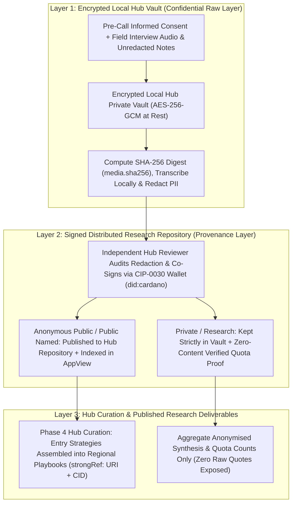

# Data Ingestion Schema and Fieldwork Verification Protocol

This protocol specifies the Phase 2–3 interview coding schema (`ingest.json` v2.0), standardised English and Spanish read-aloud participant consent scripts, confidential session audit record, data-retention controls, and cross-hub verification workflow for Phase 3 fieldwork (Weeks 7–12), extending the Milestone 1 [Ingest](../milestone-1/research-design-document/interview-guide/ingest.md), [Verify](../milestone-1/research-design-document/interview-guide/verify.md), and [Conduct](../milestone-1/research-design-document/interview-guide/conduct.md) methodology [`REF-72`].

Every stakeholder interview conducted across the three active emerging-market anchor hubs (Buenos Aires Hub, Nairobi Hub, and Lagos Hub — 3 Local Project Teams per hub = 9 Local Teams) maps directly onto the eight research Decision Gates while protecting participant privacy under applicable data-protection laws (Nigeria NDPA 2023, Kenya DPA 2019 ss. 40, 48-50 / 2021 Reg. 26, Rwanda Law 023/2026 Art. 17(1)(c), Argentina Law 25.326, and EU GDPR / EDPB Guidelines 02/2025 v2.0) [`REF-06`, `REF-18`, `REF-23`, `REF-35`, `REF-52`].

---

## 1. Methodological Continuity from Milestone 1 and Phase 3 Governance Objectives

Milestone 1 [Ingest](../milestone-1/research-design-document/interview-guide/ingest.md) established the `Conduct -> Ingest -> Verify` pipeline (structured session capture, cross-team quality review, and cryptographic contributor attribution). In Phase 2, PRISMA's research infrastructure operationalises that Milestone 1 design across three clearly separated layers: (1) encrypted local private vaults (`Hub Vault`) at each regional hub storing raw recordings and unredacted notes; (2) signed hub research repositories (`Personal Data Servers [PDS]` — each hub's signed AT Protocol database) holding only consent-cleared public or anonymous summaries; and (3) a read-only cross-hub aggregation dashboard (`AppView`) supporting Phase 4 playbook curation [`REF-69`–`REF-71`].

Ahead of primary interviews, PRISMA completed three governance baselines at Milestone 2:

1. **Published Pre-Fieldwork Consent Scripts & Ethics Sign-Off:** The Principal Investigator (Tobias Fechner) and Co-Principal Investigator (Alfred Itodole) have signed off on the Milestone 1 [Ethics](../milestone-1/research-design-document/ethics.md) and [Conduct](../milestone-1/research-design-document/interview-guide/conduct.md) safeguards and published the exact **English and Spanish Pre-Recording Read-Aloud Consent Scripts and Participant Information Summary** in Section 2.1 below.
2. **End-to-End Decision-Gate Traceability (`ingest.json` v2.0 & `audit_ledger_entry`):** The analytical coding template (`ingest.json` v2.0, Section 3.1) captures structured findings across all eight Decision Gates (`Gate 1: Regions` through `Gate 8: Cross-RFP handoffs`), paired regulatory certainty ratings, local counsel triggers (`LC-01` to `LC-10`), five-tier counterparty access progression, eight-category infrastructure ratings, and four-tier `CASS` adoption signal evaluations, paired with a dedicated non-PII `audit_ledger_entry` schema (Section 3.2) for confidential sessions.
3. **Uniform Cross-Hub Verification and Hub Curation (`Interviews -> Entry Strategies -> Playbooks`):** A standardised six-step quality-assurance and co-signing workflow governs Buenos Aires Hub, Nairobi Hub, and Lagos Hub. In Milestone 4, regional hubs carry out a curation step between verified interviews and final publication, assembling validated use-case **entry strategies** from consent-cleared evidence into each region's **Regional Entry Playbook**.

---

## 2. Three-Layer Privacy, Consent, Retention, and Provenance Architecture

To keep human-subject confidentiality separate from public provenance, the research workflow divides data handling into three operational layers [`REF-69`, `REF-70`]:



### Key Governance Controls Across the Three Layers

| Governance Control | Operational & Technical Mechanism | Privacy & Evidentiary Function During Phase 3 (`Weeks 7-12`) |
| :--- | :--- | :--- |
| **1. Standard Repository Synchronisation** | Regional hub Personal Data Servers (`PDS` — each hub's signed open-protocol research database) synchronise consent-cleared public or anonymous summaries into a read-only cross-hub aggregation dashboard (`AppView`) [`REF-69`, `REF-71`]. | Ensures every published summary is cryptographically signed by the regional hub and independent reviewer's Decentralized Identifier (`DID`) key before entering synthesis. |
| **2. Dual Identity Binding (`did:plc` + `did:cardano`)** | Self-certifying `did:cardano:stake1...` wallet identifiers verified via standard Cardano message-signing (`CIP-0030` / `CIP-0008` Ed25519 signature verification against the stake-address key hash) [`REF-65`, `REF-70`]. | Binds each regional hub (**Buenos Aires**, **Nairobi**, **Lagos**) and independent reviewer to both a repository `DID` and a verifiable Cardano stake keypair. |
| **3. Unified Four-Choice Consent Model (`1:1` M1 Mapping)** | Consent is selected and confirmed on the recording **before** interviewing begins, paired with a separate `AI model training` question (`No` by default):<br/>- **`Private`** *(Vault-only safe default)*: Raw recording and notes stay permanently inside the encrypted Hub Vault for internal scoring.<br/>- **`Research`** *(maps to M1 Confidential Synthesis)*: Personal and third-party identifiers redacted; edited anonymised transcript accessible only to CPC reviewers and authorised PRISMA synthesis researchers; never published to a public repository.<br/>- **`Anonymous public`** *(maps to M1 Role-Only Anonymised)*: Personal and organisation identifiers redacted; approved role-level findings published to the hub repository (`consentScope: "anonymous"`).<br/>- **`Public named`** *(maps to M1 Full Attribution)*: Participant-approved statements published with name, role, and organisation (`consentScope: "public"`), requiring explicit Hub Lead sign-off. | **Zero raw media ever leaves the Hub Vault.** Because any record published to an AT Protocol repository is public permanently, publication requires both explicit participant consent (`Anonymous public` or `Public named`) and passed automated + human PII redaction review. |
| **4. Zero-Content Quota Proof for Confidential Sessions** | `Private` and `Research` interviews remain inside the encrypted Hub Vault and generate a verified zero-content completion proof (or signed `audit_ledger_entry` record per Section 3.2 confirming interview date, cluster, functional role, Question Pack, and dual reviewer sign-off without exposing content). | Guarantees confidential respondents count **equally toward hub interview quotas** without pressuring sensitive regulators or officials into public attribution. Public playbooks cite **only** public or anonymous repository records via `strongRef` (a tamper-evident link pairing a record's URI with its cryptographic content hash). |
| **5. Withdrawal Rights & Data Retention Controls** | Every participant receives a withdrawal reference code (`e.g. WA-LOS-PAY-01`) before recording begins. Withdrawal removes records from the hub vault, purges backups, and issues signed deletion tombstones across PRISMA-operated servers and compliant relays (because independent third-party mirrors cannot be forced to delete scraped public records, `Public named` publication requires explicit Hub Lead sign-off).<br/>**Retention Split:**<br/>- **Raw audio/video files and unredacted personal contact identifiers:** Deleted within **12 months** of project completion under data-minimisation and national privacy rules (`NDPA 2023`, `Kenya DPA 2019 s. 40`, `Argentina Law 25.326`, `EU GDPR Art. 17`) [`REF-06`, `REF-18`, `REF-35`, `REF-52`].<br/>- **Anonymised transcripts, structured interview notes (`ingest.json` v2.0), datasets, and references:** Retained for **at least 12 months** following project completion under **Grant Agreement Appendix A, Clause 4.3** so research findings remain independently auditable and verifiable [`REF-72`]. | Separates 12-month deletion of raw identifiable media from audit retention of anonymised research records under Grant Agreement Clause 4.3. |
| **6. Post-Ingest `CIP-0020` Batch Anchoring** | Following verified cross-hub ingestion and publication of consent-cleared summaries, PRISMA anchors batch content-hash commitments on Cardano mainnet using `CIP-0020` transaction metadata (`zero PII on-chain`) [`REF-65`, `REF-69`]. | Provides tamper-evident timestamping of verified public/anonymous research batches while structured for `EDPB Guidelines 02/2025` v2.0 data minimisation (anchoring only aggregate batch repository commitments with zero individual PII, subject to DPIA review [`REF-52`]). |

### 2.1 Standardised Pre-Recording Informed Consent Scripts & Participant Information Summary

Operationalising Milestone 1 [Ethics](../milestone-1/research-design-document/ethics.md) and [Conduct](../milestone-1/research-design-document/interview-guide/conduct.md), every interviewee receives the **Participant Information Summary** ahead of the call (disclosing commissioning by the Cardano Product Committee under Grant `CPC-26-0013` / RFP 05, research purpose, voluntary participation, unconditional withdrawal via reference code, 12-month deletion of raw recordings/PII, and Clause 4.3 retention of anonymised notes) and confirms consent via the verbatim **Pre-Recording Read-Aloud Script** below before questioning begins:

- **English Read-Aloud Script (`Nairobi Hub` & `Lagos Hub`):**
  > *"Thank you for joining this research session conducted by Aspecting OÜ (Prisma) for the Cardano Product Committee under RFP 05 (Government and Emerging-Market Entry Strategy). Participation is completely voluntary; you may skip any question, pause recording, or withdraw your contribution at any time without consequence using your withdrawal code `[CODE]`. Raw audio and personal contact details stay inside our encrypted local hub vault and are deleted within 12 months of project close, while de-identified analytical notes are retained for audit under Grant Clause 4.3. Before we begin, please confirm on the record: (1) do you consent to participate; (2) do you prefer encrypted recording or written notes only; (3) which of the four confidentiality tiers do you select — `Private` (vault-only), `Research` (anonymised for CPC/researchers only), `Anonymous public` (redacted role-level summary), or `Public named` (attributed statements after your review); and (4) do you confirm our default setting excluding your responses from AI model training (`No`)?"*
- **Spanish Read-Aloud Script (`Buenos Aires Hub` — Argentina, Uruguay & Paraguay):**
  > *"Gracias por participar en esta sesión de investigación realizada por Aspecting OÜ (Prisma) para el Comité de Producto de Cardano bajo el RFP 05 (Estrategia de Entrada en Gobiernos y Mercados Emergentes). Su participación es totalmente voluntaria: puede omitir cualquier pregunta, detener la grabación o retirar su aporte en cualquier momento sin consecuencia utilizando su código de retiro `[CÓDIGO]`. El audio original y los datos personales permanecen únicamente en nuestra bóveda local cifrada y se eliminan dentro de los 12 meses posteriores al cierre del proyecto, conservándose notas anonimizadas con fines de auditoría según la Cláusula 4.3. Antes de comenzar, confirme por favor: (1) ¿consiente participar voluntariamente?; (2) ¿prefiere grabación cifrada o solo toma de notas?; (3) ¿qué nivel de confidencialidad elige: `Privado` (solo bóveda), `Investigación` (anonimizado solo para revisores CPC/Prisma), `Público anónimo` (resumen de rol sin identificadores) o `Público con atribución` (previa revisión suya)?; y (4) ¿confirma la opción predeterminada de no autorizar entrenamiento de modelos de IA (`No`)?"*

---

## 3. Analytical Coding & Confidential Audit Schemas

### 3.1 Interview Analytical Coding Schema (`ingest.json` v2.0)

To separate research methodology from wire-level repository implementation, PRISMA distinguishes the **public repository summary payload** (redacted `text`, `consentScope`, `topic`, `media.sha256`, `recordedAt`, `authorDid`, `createdAt`) from the **structured analytical coding template (`ingest.json` v2.0)** below. During peer review inside the Hub Vault, every Phase 3 interview is coded into this template to feed Milestone 3 synthesis tables and Milestone 4 hub curation:

```json
{
  "$schema": "https://json-schema.org/draft/2020-12/schema",
  "title": "PRISMA Phase 2-3 Interview Analytical Coding Template (ingest.json v2.0)",
  "schema_version": "2.0.0",
  "provenance": {
    "record_strongRef": {
      "uri": "at://did:plc:exampleteamdid/events.prisma.evidence.interview/e3b0c44298fc1c149afbf4c8996fb92427ae41e4649b934ca495991b7852b855",
      "cid": "bafyreig7x4z2m9c22p5q8w3v6n4r8k2j5h7g9f1d3s5a7q9w2e4r6t8y0u"
    },
    "hub_did_plc": "did:plc:examplehubpds",
    "hub_did_cardano": "did:cardano:stake1u9examplecardanostakekeyhash...",
    "team_did_plc": "did:plc:exampleteamdid",
    "authorDid": "did:cardano:stake1u8examplereviewerstakekeyhash...",
    "media": {
      "sha256": "e3b0c44298fc1c149afbf4c8996fb92427ae41e4649b934ca495991b7852b855",
      "mimeType": "audio/ogg",
      "kind": "voice | video | file | text"
    },
    "verification_status": "vault_private | vault_research_verified | verified_published | disputed | withdrawn",
    "recordedAt": "2026-12-08T10:00:00Z",
    "createdAt": "2026-12-09T16:30:00Z"
  },
  "conduct": {
    "withdrawal_reference_code": "WA-LOS-PAY-01",
    "play_id": "H1 | H2 | H3 | H4 | H5 | H6 | H7 | H8 | H9 | H10 | H11 | H12 | H13 | H14 | H15",
    "use_case": "Remittances | Identity_Credentials | Land_Records | Ag_Supply_Chain | Stablecoin_Settlement | Public_Procurement_Audit",
    "question_pack": "public-sector | regulators-policy | humanitarian-ngo | delivery-partners | payment-infrastructure | agricultural-networks | cardano-ecosystem",
    "screener_passed": true,
    "consent_choice": "Private | Research | Anonymous public | Public named",
    "m1_consent_mapping": "Vault-Only Default (Private) | Confidential Synthesis (Research) | Role-Only Anonymised (Anonymous public) | Full Attribution (Public named)",
    "consentScope": "vault_only | anonymous | public",
    "ai_training_consent": false,
    "recording_mode": "recorded_vault_encrypted | notes_only | text_intake",
    "consent_recorded_before_start": true,
    "anonymous": true,
    "re_contact": false,
    "lead_interviewer_role_separated_from_introducer": true
  },
  "participant": {
    "id": "NG-LAG-001",
    "counterparty_register_id": "CP-WA-03",
    "stakeholder_category": "1_public_sector | 2_regulators_policy | 3_humanitarian_ngo | 4_delivery_partners | 5_payment_infrastructure | 6_agricultural_networks | 7_cardano_ecosystem",
    "functional_role": "R1_Decision_Sponsor | R2_Regulatory_Gatekeeper | R3_Procurement_Budget_Owner | R4_Local_Delivery_Partner | R5_Distribution_Trust_Partner | R6_Technical_Compliance_Enabler",
    "cardano_affiliation": "non_cardano | cardano_adjacent | cardano_insider",
    "ecosystem_relationship_tag": "IND-COLD | PRISMA-HUB | CATS26-WARM | WADA-NET | CARDANO-ECO",
    "coi_flag": false,
    "coi_disclosure": "None - independent SEC-regulated VASP operating on Tron and EVM rails."
  },
  "metadata": {
    "date_time": "2026-12-08T10:00:00Z",
    "country": "Argentina | Uruguay | Paraguay | Nigeria | Ghana | Senegal | Kenya | Rwanda | Uganda | Spain | Brazil | Colombia | Peru | Mexico | Ethiopia",
    "region": "Southern Cone | East Africa | West Africa | Iberia | Brazil | Andean | Mexico | Horn_Ethiopia",
    "hub_anchor": "Buenos Aires Hub | Nairobi Hub | Lagos Hub | Desk Monitor",
    "language": "en | es | fr | sw | pt",
    "stakeholder": "Anonymised Institutional Archetype Label (e.g. SEC Nigeria-Licensed VASP Settlement Desk)",
    "interviewer": "Hub Team ID (e.g. LAG-TEAM-01)",
    "independent_reviewer": "Hub Reviewer ID (e.g. LAG-REV-01)"
  },
  "decision_gates": {
    "gates_addressed": [
      "Gate 1: Regions",
      "Gate 2: Use cases",
      "Gate 3: Counterparties",
      "Gate 4: Regulation",
      "Gate 5: Infrastructure",
      "Gate 6: Delivery model",
      "Gate 7: Adoption",
      "Gate 8: Cross-RFP handoffs"
    ],
    "primary_gate_findings": {
      "gate_1_regions": "Validates or revises cluster RARF score across D1-D10.",
      "gate_2_use_cases": "Tests specific falsification threshold for play_id (H1-H15).",
      "gate_3_counterparties": "Upgrades counterparty access_basis from Warm/Referred/Desk to Interviewed.",
      "gate_4_regulation": "Verifies LC-01 to LC-10 statutory and compliance questions.",
      "gate_5_infrastructure": "Rates the 8 prerequisite categories (Met / Partially Met / Unmet / Unknown / Dependent).",
      "gate_6_delivery_model": "Evaluates local SI SLA capacity and 6-role partnership completeness.",
      "gate_7_adoption": "Identifies hard falsification or No-Go triggers.",
      "gate_8_cross_rfp_handoffs": "Logs external protocol/liquidity dependencies (HO-M2-01 to HO-M2-05)."
    },
    "play_status_after_call": "confirmed | revised | contested-weak | rejected | inconclusive",
    "rarf_dimensions_tested": ["D1", "D2", "D3", "D4", "D5", "D6", "D7", "D8", "D9", "D10"]
  },
  "business_value": {
    "use_case": "",
    "adoption": "",
    "commercial": "",
    "market_access": "",
    "deployment": "",
    "incumbent_baseline_named": "e.g. NIBSS NIP + Tron TRC-20 USDT OTC desks",
    "why_cardano_vs_centralised_db_or_competing_chain": "Explicit operational comparison captured from respondent."
  },
  "counterparty_lead": {
    "archetype_or_entity_code": "CP-WA-03",
    "functional_role": "R6_Technical_Compliance_Enabler",
    "access_basis_before_call": "Warm Access | Referred | Desk-Identified | Hypothetical",
    "access_basis_after_call": "Interviewed",
    "reachability_12_24m": "High | Medium | Low",
    "referral_captured": false,
    "referral_permission_granted": false
  },
  "regulatory_finding": {
    "jurisdiction": "Nigeria",
    "local_counsel_trigger_id": "LC-03",
    "competent_authorities": ["SEC Nigeria", "Central Bank of Nigeria (CBN)"],
    "statutory_citations": ["Investments and Securities Act 2025 (ISA 2025)", "SEC Circular No. 26-1 (2026-01-16)", "CBN Circular FPR/DIR/PUB/CIR/002/003 (2023-12-22)"],
    "regulatory_certainty_paired": "Clear (High Certainty) | Evolving (Medium Certainty) | Uncertain (Low Certainty)",
    "specialist_local_counsel_required": "Yes - Mandatory Before Pilot | Conditional - Required for Licensing/Tender | No - Standard Compliance Only",
    "counsel_trigger_rationale": ""
  },
  "infrastructure_assessment": {
    "stablecoin_liquidity": "Met | Partially Met | Unmet | Unknown | Dependent on Another Workstream",
    "local_off_ramp": "Met | Partially Met | Unmet | Unknown | Dependent on Another Workstream",
    "wallet_ux_abstraction": "Met | Partially Met | Unmet | Unknown | Dependent on Another Workstream",
    "mobile_first_offline_ussd": "Met | Partially Met | Unmet | Unknown | Dependent on Another Workstream",
    "privacy_selective_disclosure": "Met | Partially Met | Unmet | Unknown | Dependent on Another Workstream",
    "identity_kyc_integration": "Met | Partially Met | Unmet | Unknown | Dependent on Another Workstream",
    "local_delivery_capacity": "Met | Partially Met | Unmet | Unknown | Dependent on Another Workstream",
    "compliance_sla_artifacts": "Met | Partially Met | Unmet | Unknown | Dependent on Another Workstream"
  },
  "adoption_signal": {
    "signal_present": false,
    "cass_signal_id": "CASS-M2-05",
    "signal_description": "",
    "evidence_type": "Primary_Observation | Documentary_Contract | Third_Party_Independent | Unverified_Assertion",
    "proposed_cass_tier": "Tier 1: Verified Adoption Signal | Tier 2: Strong Opportunity Signal | Tier 3: Moderate / Exploratory Signal | Tier 4: Weak / Cosmetic Signal",
    "cass_rationale": "",
    "prior_community_claim_reclassified": false
  },
  "cross_rfp_handoff": {
    "handoff_triggered": true,
    "handoff_id": "HO-M2-01",
    "target_rfp": "RFP-01_Customer_Segmentation | RFP-02_Use_Case_Landscape | RFP-03_Stablecoin_Liquidity | RFP-06_Enterprise_RWA_Readiness | RFP-07_Interoperability | RFP-08_Enterprise_Delivery_Partners | None",
    "blocker_summary": "",
    "requested_receiving_action": ""
  },
  "evidence": {
    "observation": "",
    "counterevidence_or_limitation": "",
    "source": "Primary_Interview | Secondary_Statutory | Secondary_Institutional | Community_Self_Report",
    "confidence": "High (Triangulated Primary) | Medium (Single Primary or Convergent Secondary) | Low (Desk Estimate or Unverified Claim)"
  }
}
```

*(Note: Example values and ISO timestamps above are illustrative placeholders for Phase 3 fieldwork.)*

### 3.2 Confidential Session Non-PII Audit Ledger Schema (`audit_ledger_entry`)

For every `Private` or `Research` session retained inside a local Hub Vault, PRISMA logs a signed, non-PII `audit_ledger_entry` record so sample quotas, category diversity, and COI caps remain verifiable without exposing confidential interview content:

```json
{
  "audit_ledger_version": "1.0.0",
  "session_id": "WA-LOS-PAY-01",
  "hub_anchor": "Buenos Aires Hub | Nairobi Hub | Lagos Hub",
  "interview_date_utc": "2026-12-08",
  "counterparty_archetype_id": "CP-WA-03",
  "question_pack_category": "5_payment_infrastructure",
  "functional_role": "R6_Technical_Compliance_Enabler",
  "coi_flag": false,
  "consent_choice": "Private | Research",
  "vault_media_or_notes_sha256": "e3b0c44298fc1c149afbf4c8996fb92427ae41e4649b934ca495991b7852b855",
  "interviewer_did": "did:cardano:stake1u9exampleinterviewer...",
  "independent_reviewer_did": "did:cardano:stake1u8examplereviewer...",
  "dual_signoff_verified": true
}
```

### Schema-to-Deliverable Traceability Mapping

| `ingest.json` v2.0 Block | Milestone 1 Design Specification | Phase 2 Baseline Deliverable | Downstream Phase 3-5 Analytical Output |
| :--- | :--- | :--- | :--- |
| **`provenance`** (`record_strongRef`, `hub_did_plc`, `hub_did_cardano`, `authorDid`, `media.sha256`, `verification_status`) | [Ingest](../milestone-1/research-design-document/interview-guide/ingest.md) & [Verify](../milestone-1/research-design-document/interview-guide/verify.md) | [Data Ingestion Schema and Fieldwork Verification Protocol](./phase-2-schema-and-protocol-update.md) | Links each Milestone 3 synthesis table and Milestone 4-5 curated entry strategy / playbook claim to a content-addressed `at:// URI + CID` and `SHA-256` vault digest (or zero-content quota proof for confidential sessions). |
| **`decision_gates`** (`gates_addressed`, `primary_gate_findings`, `play_status_after_call`, `rarf_dimensions_tested`) | [Decision Gates](../milestone-1/research-design-document/decision-gates.md) (`Gates 1-8`) | [Regional Market Prioritisation Matrix](./market-prioritisation-matrix.md) & [Use-Case Viability Register](./desk-research-and-use-case-scan.md) | Drives post-interview RARF re-scoring (`D1-D10`) and final hypothesis disposition (`confirmed`, `revised`, `rejected`) in Milestones 3 and 4. |
| **`counterparty_lead`** (`archetype_or_entity_code`, `functional_role`, `access_basis_before_call`, `access_basis_after_call`) | [Stakeholder Recruitment Plan](../milestone-1/research-design-document/stakeholder-recruitment-plan.md) | [Stakeholder Ecosystem and Counterparty Mapping Report](./counterparty-access-map.md) | Tracks progression from `Warm Access`, `Referred`, or `Desk-Identified` to `Tier 1: Interviewed` across all six functional roles (`R1-R6`). |
| **`regulatory_finding`** (`local_counsel_trigger_id`, `regulatory_certainty_paired`, `specialist_local_counsel_required`) | [Regulators Question Pack](../milestone-1/research-design-document/question-packs/regulators.md) | [Preliminary Regulatory and Compliance Scan](./regulatory-preliminary-scan.md) (`LC-01` to `LC-10`) | Feeds the Primary-Verified Regulatory and Compliance Matrix in Milestones 4 and 5. |
| **`infrastructure_assessment`** (8 categories rated `Met` / `Partially Met` / `Unmet` / `Unknown` / `Dependent`) | [Adoption Readiness](../milestone-1/research-design-document/adoption-readiness.md) | [Regional Market Prioritisation Matrix](./market-prioritisation-matrix.md) (`Section 5`) | Feeds the Infrastructure Prerequisite and Gap Assessment in Milestones 4 and 5. |
| **`adoption_signal`** (`cass_signal_id`, `proposed_cass_tier`, `prior_community_claim_reclassified`) | [Adoption Signals](../milestone-1/research-design-document/adoption-signals.md) (`CASS Tiers 1-4`) | [Use-Case Viability Register](./desk-research-and-use-case-scan.md) (`Section 6`) | Governs whether a regional signal advances from `Tier 3` to `Tier 2` or `Tier 1` following independent primary verification. |
| **`cross_rfp_handoff`** (`handoff_id`, `target_rfp`, `blocker_summary`, `requested_receiving_action`) | [Decision Gates](../milestone-1/research-design-document/decision-gates.md) (`Gate 8`) | [Regional Market Prioritisation Matrix](./market-prioritisation-matrix.md) (`Section 6`) | Routes validated ecosystem dependencies to CPC portfolio workstreams (`RFP 01`, `RFP 02`, `RFP 03`, `RFP 06`, `RFP 07`, `RFP 08`) in Milestones 4 and 5. |

---

## 4. Six-Step Cross-Hub Fieldwork Verification Checklist

To apply consistent evidentiary, privacy, and bias-control standards across Buenos Aires Hub, Nairobi Hub, and Lagos Hub (9 Local Project Teams total), field teams complete the six-step checklist in Table 2 before counting any session toward Phase 3 sample quotas.

| Step | Workflow Stage | Operational Requirement Across All Regional Hubs | Technical & Governance Verification Mechanism |
| :-: | :--- | :--- | :--- |
| **1** | **Pre-Call `Assemble` & Screener Check** | Prior to each interview, the lead interviewer populates the six-row `Assemble` header (`Cluster`, `Use case`, `Play one-liner`, `Hypothesis status`, `Desk claims to test`, `What would falsify this play`) from the [Use-Case Viability Register](./desk-research-and-use-case-scan.md) and verifies the Question Pack Screener (`screener_passed: true`). | Recorded in `conduct.play_id`, `conduct.question_pack`, and `conduct.screener_passed`. |
| **2** | **Role Segregation & Blockchain-Agnostic Discovery** | Where a participant was introduced through a regional hub, `Wada`, or `CATS26` contact (`PRISMA-HUB`, `CATS26-WARM`, `WADA-NET`, `CARDANO-ECO`), the person who made the introduction does not serve as sole lead interviewer or final verifier (`lead_interviewer_role_separated_from_introducer: true`). The first `60%` of the session focuses on blockchain-agnostic operational problem and incumbent-system discovery. | Verified through distinct `metadata.interviewer` and `metadata.independent_reviewer` identifiers and signed reviewer `provenance.authorDid`. |
| **3** | **Pre-Recording Informed Consent & Encrypted Vault Upload (`Within 48h`)** | Using the verbatim English or Spanish Read-Aloud Consent Script (Section 2.1), consent level (`Private`, `Research`, `Anonymous public`, or `Public named`, plus `AI training: No` default) is confirmed aloud **before** recording begins (`conduct.consent_recorded_before_start: true`), and the participant receives their withdrawal code. Raw audio and notes are uploaded into the encrypted local Hub Vault (`Private` by default), computing `provenance.media.sha256`. | Encrypted local storage blocks unauthenticated external reads; raw recordings and `Private` or `Research` sessions never leave the local hub vault. |
| **4** | **Local Transcription, PII Redaction & Structured Coding (`Within 48h`)** | Local transcription and automated + human PII review flag personal names, third-party names, phone numbers, emails, and indirect identifiers. The interviewer and reviewer verify consent matches the recorded statement (tightening scope automatically if narrower, or escalating conflicts to the Hub Lead), remove all flagged identifiers (unless the participant chose `Public named`), and complete all Decision-Gate blocks, including `business_value.incumbent_baseline_named` and `evidence.counterevidence_or_limitation`. | Automated review gate refuses `anonymous` approval while any phone number, email, link, or unredacted personal identifier remains visible. |
| **5** | **Independent Hub Peer-Review & Gated Publication (`Within 72h`)** | An independent reviewer (or cross-hub fallback reviewer) compares the encrypted vault draft against the redacted summary to verify: (a) all personal and third-party identifiers are removed; (b) courtesy statements are not miscoded as `CASS Tier 1` or `Tier 2`; and (c) counterevidence is captured. For `Anonymous public` and `Public named` records (Hub Lead sign-off required for `Public named`), the reviewer signs with their `did:cardano:stake1...` wallet (`provenance.authorDid`) to publish to the hub repository. `Private` and `Research` sessions remain inside the vault and emit both a zero-content completion proof and a signed non-PII `audit_ledger_entry` row (Section 3.2). | Cryptographic signature verification writes approved public/anonymous records keyed by `provenance.media.sha256`, generating a tamper-evident `strongRef` (`at:// URI + CID`), while confidential sessions log verifiable `audit_ledger_entry` hashes for CPC Milestone 3 audit. `CIP-0020` batch anchoring follows post-ingest. |
| **6** | **Aggregation, Weekly Calibration & Phase 4 Hub Curation** | The cross-hub aggregation dashboard verifies signatures and tracks regional quota completion and category balance across published `strongRef` records and confidential `audit_ledger_entry` proofs. During weekly calibration reviews in Weeks 7-12, the Co-PI / Project Lead and Principal Investigator audit sample records across Buenos Aires, Nairobi, and Lagos to maintain inter-rater consistency. In Milestone 4, hubs curate validated **entry strategies** citing only public/anonymous `strongRef` records and verified references into the three **Regional Entry Playbooks**. | De-duplicated record tracking across published summaries and signed confidential `audit_ledger_entry` rows guarantees accurate Milestone 3 quota accounting while enforcing public citation traceability (`strongRef`) in Milestone 4 playbooks. |
